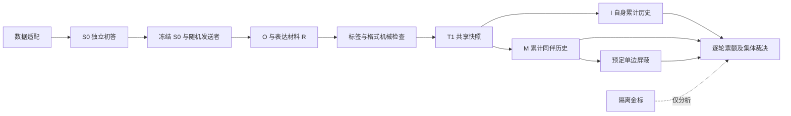

# 受控 MAD 完整实验框架

Python 3.11+，适用于 macOS/Linux/Windows，运行时仅用标准库。从数据导入、独立 S0 和修辞材料生成到三轮四格、消息干预与分析使用同一任务状态机；另有独立的 RQ2 五轮 MAD 补充实验。

## 直接运行

```bash
cd controlled-mad-framework-v1
export PYTHONPATH=src
python3 -m controlled_mad validate --config configs/demo.json
python3 -m controlled_mad plan --config configs/demo.json
python3 -m controlled_mad init --config configs/demo.json --run-id my-demo
python3 -m controlled_mad run --run-id my-demo --backend mock
python3 -m controlled_mad status --run-id my-demo
python3 -m controlled_mad verify --run-id my-demo
python3 -m controlled_mad analyze --run-id my-demo
python3 -m controlled_mad trace --run-id my-demo --item-id toy-001
```

my-demo 必须是未使用过的 run_id。演示含 6 道合成题、四标签和二标签空间、三种初态及材料不适用情况。模拟结果仅验证工程流程，不能当作研究结论。

## 随仓库提供的数据和配置

- [datasets/README.md](datasets/README.md) 列出 AVeriTeC dev、WiCE 文件、来源、许可及 SHA-256。AVeriTeC dev 可直接供本框架使用；WiCE 是研究候选，当前尚无本框架适配器。
- `configs/averitec-rq1-*.json` 保留已有 MiniMax 配置参数，数据路径改为仓库内的 `../datasets/averitec/dev.json`；早期配置的审核开关仍按原版语义解释。
- `configs/averitec-rq2-five-round-minimax-m31-flash-template.json` 沿用 MiniMax-M3.1-Flash，并以固定种子从 500 题抽取 100 题。`plan` 的任务上界为 6600。正式运行前核对题目子集和预算。

配置只保存凭据环境变量名 `MINIMAX_API_KEY`，不保存密钥。真实模型调用需在终端设置该变量，并使用 `--allow-network`。

## RQ2 五轮补充实验

`configs/rq2-five-round-demo.json` 从合成集按题号和种子选 2 题；`configs/rq2-five-round-real-template.json` 是 AVeriTeC 100 题的通用容量模板。也可将 `subset` 改成 `{"item_ids":["averitec_0001", "averitec_0002"]}`。

```bash
PYTHONPATH=src python3 -m controlled_mad plan --config configs/rq2-five-round-demo.json
PYTHONPATH=src python3 -m controlled_mad rq2 --config configs/rq2-five-round-demo.json --run-id rq2-demo --backend mock
PYTHONPATH=src python3 -m controlled_mad analyze --run-id rq2-demo
```

首次 `rq2` 命令冻结新的运行，同一命令再次执行会检查配置并续跑；真实服务还需在冻结配置中开启 `network_enabled`，并显式加 `--allow-network`。五轮仅运行 M-O/M-R，T1—T4 是暂定判断，T5 是终局。子集不根据金标或运行结果筛选。报告给出逐轮票额/裁决差、T3→T5 变化及完整五轮配对分母。这个补充实验不输出三轮四格 D；旧三轮 run 不会变成五轮 run。

Windows PowerShell 示例，建议使用短运行目录以减小路径长度：

```powershell
cd controlled-mad-framework-v1
$env:PYTHONPATH = "src"
python -m controlled_mad rq2 --config configs/rq2-five-round-demo.json --run-id rq2-demo --runs-root C:\mad-runs --backend mock
python -m controlled_mad status --run-id rq2-demo --runs-root C:\mad-runs
python -m controlled_mad verify --run-id rq2-demo --runs-root C:\mad-runs
python -m controlled_mad analyze --run-id rq2-demo --runs-root C:\mad-runs
```

真实运行时在 PowerShell 当前会话设置配置中指定的凭据环境变量；程序不会读取 `.env`。Windows 文件锁和 UTF-8/BOM 路径已适配，目录 fsync 的断电持久化保证依平台而异。

## 架构与实验约定



三人、三轮、完整累计历史；同一版本 T1 在 I/M 间共享；多个表达比较可引用同一 O。O/O 两批诊断独立。屏蔽消息不进入接收者历史，后续不会自动补回，其他人的转述仍可传播。

各题各轮输出 vote/verdict 的完整标签向量及四格差，no_majority 与运行缺失分开。主轨迹用三轮均完整、重复编号对齐的四格集合；准确率和覆盖率另外报告。首版不作统计推断。

## 配置与更换任务

- 已支持的数据适配器：本地 AVeriTeC JSON、MMLU-Pro JSON/JSONL、BBQ JSON/JSONL 和通用 JSONL；均转为统一任务输入，并将金标隔离到分析阶段。MMLU-Pro/BBQ 当前完成适配器与导入校验，尚未接入完整实验运行。
- AVeriTeC 是当前端到端流程验证数据集。MMLU-Pro 保留学科/source 元信息，BBQ 保留偏差类别、歧义条件等分层字段；`validate` 会报告这些字段的计数。数据采样、每集题数及正式实验调用仍需单独冻结。
- 已支持的后端：mock、OpenAI-compatible、Anthropic-compatible。服务地址、模型、参数、seed 能力和模型返回标识通过 profiles 配置；支持的服务内换模型不改路由代码。
- 原始 S0 comment 是 O 的唯一来源。修辞材料由配置模型按 `prompts/rhetoric.v1.txt` 生成，默认不调用另一个模型做语义审核；程序检查标签、非空输出及是否与原文完全相同。位置和论据顺序通过精确原文块重排。材料提示要求保留证据和论证含义，但自动流程不验证语义等价；因此实验结论应描述为“按受控提示生成的修辞改写”，不能声称每条材料均已人工或模型确认无语义漂移。
- 旧版冻结配置若没有 `material_audit` 字段，仍按旧行为启用审核，以便只读旧运行和继续恢复旧记录。新配置显式设为 `false`；审核阶段的任务上界显示为 0。
- 正式配置模板在 configs/real-template.json；默认网络关闭，程序不读取 .env。真实模型快照、重复数、预算和停止规则仍须冻结。当前验收只证明离线流程和 HTTP 契约，未做真实模型联调。

## 日志与恢复

runs/<run_id>/ 保存冻结配置、可见输入、隔离金标、任务、消息、投递、原始响应、各版解析、快照和事件。raw 与派生版本不可覆盖，verify 检查哈希与引用。

resume 从保存的任务状态继续执行，传输结果未知时按尝试上限退避重试。reparse 不调模型；retry 显式建立新尝试；fork-revision 选定新解析并保留旧运行。

## 验证与开发

```bash
PYTHONPATH=src python3 -m unittest discover -s tests -v
python3 -m compileall -q src tests
```

测试包括真实子进程在提交 raw 后异常退出、重启恢复、上游修复隔离、共享 O 计数、完整历史、消息屏蔽与缺失分母。
